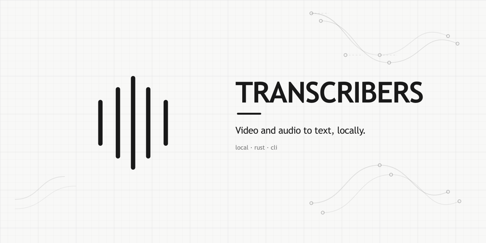
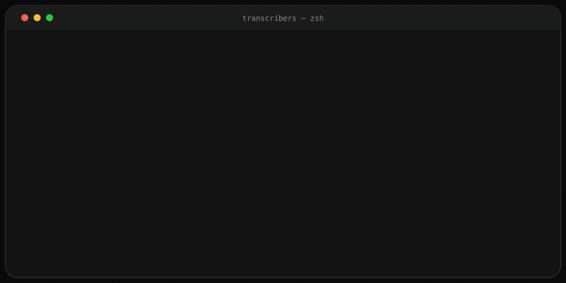

# transcribers

[](https://github.com/hieudoanm/transcribers/actions/workflows/ci.yaml?branch=master)  [](LICENSE)

Topics: `transcription`, `whisper`, `rust`, `cli`, `ffmpeg`

Video and audio to text, locally.



**Live demo:** [transcribers landing page]



- Extract transcripts from video and audio files with a single Rust binary.
- Powered by `ffmpeg` for audio extraction and `whisper.cpp` for transcription.
- whisper.cpp is compiled into the binary at build time — no separate whisper install.
- Runs fully offline; media never leaves your machine.
- Outputs plain text, SRT, WebVTT subtitles, or JSON with timestamps.

## Features

- Single static binary (~1.6 MB) with whisper.cpp linked in.
- whisper models (`tiny` through `large-v3`, multilingual and `.en` variants) resolved by name.
- Models download automatically on first use into `~/.cache/transcribers/models/`.
- Language auto-detection or explicit language codes.
- Prebuilt releases for macOS (arm64) and Linux (x86_64) via `install.sh`.
- Cargo workspace with focused crates: `transcribers-cli`, `transcribers-ffmpeg`,
  `transcribers-models`, `transcribers-whisper`.
- CI builds, tests, publishes the `latest` GitHub release, and deploys the landing page.

## Get Started

```bash
# install from a prebuilt release binary (falls back to source build)
curl -fsSL https://raw.githubusercontent.com/hieudoanm/transcribers/master/scripts/install.sh | bash

# or from a local checkout
./scripts/install-local.sh
```

Both install to `~/.local/bin` by default; override with `INSTALL_DIR`.

### Build from source

```bash
cargo build --release        # also prints the binary size
./target/release/transcribers --version
cargo test --workspace
```

### Transcribe

```bash
# srt transcript to stdout (default format)
transcribers --file video.mp4

# subtitles file
transcribers --file video.mp4 -f srt -o out/video

# other options
transcribers --file video.mp4 --model small.en --language en --format vtt
transcribers --file video.mp4 --format json --output transcript.json

# clip a section, bias recognition, translate
transcribers --file video.mp4 --start 30 --duration 120 --prompt "Dr. Smith" --translate

# convert to audio only (no model download, no transcription)
transcribers --file video.mp4 --audio-only --audio mp3        # -> video.mp3 in cwd

# transcript plus audio file next to the output
transcribers --file video.mp4 -f srt -o out/video --audio m4a # -> out/video.srt + out/video.m4a

# keep the intermediate 16 kHz WAV for inspection
transcribers --file video.mp4 --keep-audio

# download a YouTube video/short or Instagram reel, then transcribe
transcribers --url "https://www.youtube.com/watch?v=jNQXAC9IVRw" -f srt -o out/video
```

Options:

- `--file <PATH>` — local video/audio file (mp4, mkv, mov, wav, mp3, ...).
  Mutually exclusive with `--url`; one of the two is required.
- `--url <URL>` — `http(s)` URL (YouTube videos/shorts, Instagram reels,
  ...); media is downloaded via the `yt-dlp` crate first.
- `-m`, `--model <MODEL>` — whisper model name (`tiny`, `base`, `small`,
  `medium`, `large`, `*.en`, ...) or path to a local `.bin` file.
  Default: `base.en`; missing models download automatically.
- `--list-models` — list known model names and exit.
- `-l`, `--language <LANG>` — spoken language code or `auto` for detection.
  Default: `auto`.
- `-f`, `--format <FORMAT>` — output format: `txt`, `srt`, `vtt`, `json`.
  Default: `srt`.
- `-o`, `--output <PATH>` — write output to `PATH` instead of stdout
  (`-` = stdout); the format extension is appended unless `PATH` already
  has one.
- `-t`, `--threads <N>` — decoder threads. Default: auto (available
  parallelism, capped at 8).
- `--start <SEC>` — start transcription `SEC` seconds into the media.
- `--duration <SEC>` — transcribe at most `SEC` seconds.
- `--prompt <TEXT>` — initial prompt to bias recognition (names, jargon).
- `--translate` — translate speech into English.
- `--keep-audio` — keep the extracted 16 kHz WAV next to the output and
  print its path.
- `-a`, `--audio <FORMAT>` — also write the audio track as `wav`, `mp3`
  or `m4a` (source sample rate kept).
- `--audio-only` — only convert audio (requires `--audio`); skips model
  download and transcription.
- `-V`, `--version` — print version and build time.
- `-h`, `--help` — show help.

Model names (`tiny`, `base`, `small`, `medium`, `large`, `*.en`, ...) are
downloaded from [whisper.cpp on Hugging Face]; you can also
pass a path to a local `.bin` model file.

## Examples

`examples/videos/` holds sample inputs, `examples/urls.txt` sample URLs
(YouTube, Instagram), and `examples/transcripts/` the generated output.
Re-run the batch script with:

```bash
./examples/examples.sh                  # FORMAT/MODEL/AUDIO env vars supported
```

## Requirements

- `ffmpeg` on `PATH` (`brew install ffmpeg`); `ffprobe` ships with ffmpeg
  and enables a fast `no audio stream found` check (skipped if absent)
- `curl` for one-time model downloads
- Building from source needs `cmake` and a C++ toolchain

## Environment variables

| Variable                 | Effect                                                                        |
| ------------------------ | ----------------------------------------------------------------------------- |
| `TRANSCRIBERS_MODEL_DIR` | Directory holding `ggml-*.bin` models (overrides cache)                       |
| `XDG_CACHE_HOME`         | Base for the default model cache (`$XDG_CACHE_HOME/transcribers/models`)      |
| `INSTALL_DIR`            | Install target for `install.sh` / `install-local.sh` (default `~/.local/bin`) |

## Exit codes

- `0` — success (`--help`, `--version`, `--list-models` included)
- `1` — runtime failure (bad input, ffmpeg/whisper/model errors)
- `2` — usage error (missing/unknown arguments, invalid values)

Diagnostics and progress (`transcribing... N%`, `wrote ...`) go to stderr;
stdout carries only the transcript when writing to stdout.

## HTTP server

`transcribers serve [--host 127.0.0.1] [--port 8080]` starts a small HTTP
API. `POST /transcribe` accepts `multipart/form-data` with a `file` upload
or a `url` field (yt-dlp download), plus optional `model`, `language`,
`format`, `threads`, `start`, `duration`, `prompt`, `translate` fields —
the response body is the rendered transcript. `GET /health` returns `ok`.

```bash
transcribers serve --port 8080
curl -F "file=@video.mp4" -F "format=srt" http://127.0.0.1:8080/transcribe
curl -F "url=https://www.youtube.com/watch?v=jNQXAC9IVRw" http://127.0.0.1:8080/transcribe
```

## MCP server

`transcribers mcp` runs a minimal MCP server over stdio JSON-RPC
(`transcribers-mcp`, protocol `2024-11-05`). Tools delegate to the CLI so
behaviour always matches; point an MCP client at the `transcribers` binary
with args `["mcp"]`.

## Documentation

| Document                                     | Purpose                                          |
| -------------------------------------------- | ------------------------------------------------ |
| [`docs/usage.md`](docs/usage.md)             | CLI options, output formats, and model selection |
| [`docs/development.md`](docs/development.md) | Workspace layout, build and install scripts      |
| [`AGENTS.md`](AGENTS.md)                     | Project guide for coding agents                  |
| [`crates/`](crates/)                         | Per-crate READMEs and AGENTS notes               |

## Landing site

The static landing page lives in [`packages/landing/`](packages/landing/) and
is deployed to GitHub Pages by CI.

## License

This project is licensed under the [GNU GPL-3.0](LICENSE) — required by the
`yt-dlp` crate used for URL downloads.

[transcribers landing page]: https://hieudoanm.github.io/transcribers/
[whisper.cpp on Hugging Face]: https://huggingface.co/ggerganov/whisper.cpp


### Streamable HTTP

`transcribers mcp --http 127.0.0.1:8080` also accepts `--http <addr>` (and `--token <token>`, or the
`MCP_AUTH_TOKEN` environment variable) to serve the same MCP surface over
streamable HTTP at `http://<addr>/mcp` — the transport used by ChatGPT
connectors and remote Claude clients. When a token is configured, every
request must carry `Authorization: Bearer <token>`.
