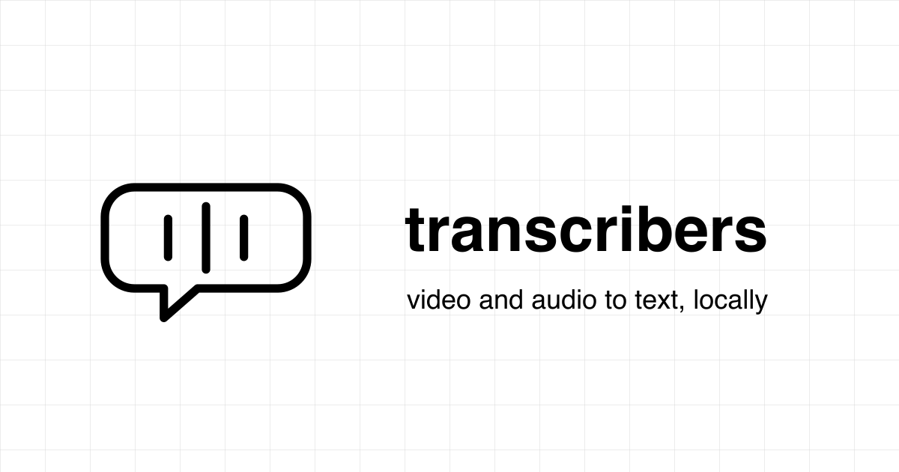

<p align="center">
  
</p>

<h1 align="center">transcribers</h1>

<p align="center">
  Video and audio to text, locally.
</p>

<p align="center">
  
</p>

- Extract transcripts from video and audio files with a single Rust binary.
- Powered by `ffmpeg` for audio extraction and `whisper.cpp` for transcription.
- whisper.cpp is compiled into the binary at build time — no separate whisper install.
- Runs fully offline; media never leaves your machine.
- Outputs plain text, SRT, WebVTT subtitles, or JSON with timestamps.

## Status

- Single static binary (~1.6 MB) with whisper.cpp linked in.
- whisper models (`tiny` through `large-v3`, multilingual and `.en` variants) resolved by name.
- Models download automatically on first use into `~/.cache/transcribers/models/`.
- Language auto-detection or explicit language codes.
- Prebuilt releases for macOS (arm64) and Linux (x86_64) via `install.sh`.
- Cargo workspace with focused crates: `ffmpeg`, `models`, `whisper`, `transcribers`.
- CI builds, tests, publishes the `latest` GitHub release, and deploys the landing page.

## Quick start

```bash
# install from a prebuilt release binary (falls back to source build)
curl -fsSL https://raw.githubusercontent.com/hieudoanm/transcribers/main/scripts/install.sh | bash

# or from a local checkout
./scripts/install-local.sh
```

Both install to `/usr/local/bin` (`install.sh`) or `~/.local/bin`
(`install-local.sh`); override with `INSTALL_DIR`.

### Build from source

```bash
cargo build --release        # also prints the binary size
./target/release/transcribers --version
cargo test --workspace
```

### Transcribe

```bash
# srt transcript to stdout (default format)
transcribers video.mp4

# subtitles file
transcribers video.mp4 -f srt -o out/video

# other options
transcribers video.mp4 --model small.en --language en --format vtt
transcribers video.mp4 --format json --output transcript.json
```

Options: `-m/--model` (default `base.en`), `-l/--language` (default `auto`),
`-f/--format` (`txt`, `srt`, `vtt`, `json` — default `srt`), `-o/--output`,
`--keep-audio`, `-V/--version`.

Model names (`tiny`, `base`, `small`, `medium`, `large`, `*.en`, ...) are
downloaded from <https://huggingface.co/ggerganov/whisper.cpp>; you can also
pass a path to a local `.bin` model file.

## Examples

`examples/videos/` holds sample inputs and `examples/transcripts/` the
generated output. Re-run the batch script with:

```bash
./examples/examples.sh                  # FORMAT and MODEL env vars supported
```

## Requirements

- `ffmpeg` on `PATH` (`brew install ffmpeg`)
- `curl` for model downloads
- Building from source needs `cmake` and a C++ toolchain

## Documentation map

| Document                                     | Purpose                                          |
| -------------------------------------------- | ------------------------------------------------ |
| [`docs/usage.md`](docs/usage.md)             | CLI options, output formats, and model selection |
| [`docs/development.md`](docs/development.md) | Workspace layout, build and install scripts      |
| [`AGENTS.md`](AGENTS.md)                     | Project guide for coding agents                  |
| [`crates/`](crates/)                         | Per-crate READMEs and AGENTS notes               |

## Landing site

The static landing page lives in [`packages/landing/`](packages/landing/) and
is deployed to GitHub Pages by CI.
